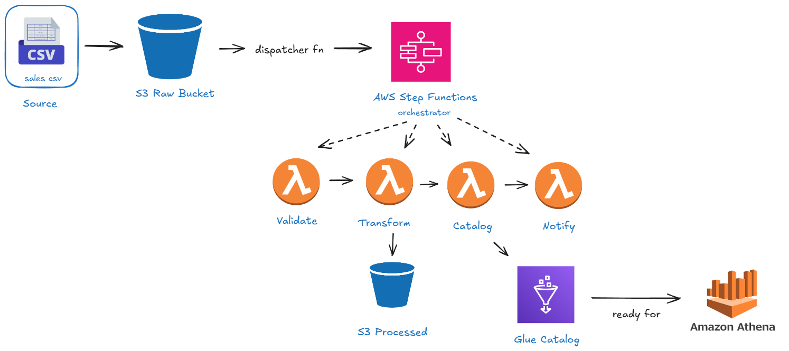

# Fashionstore Data Pipeline

Pipeline using Python, boto3, and LocalStack to process sales CSV files with S3, Lambda, Step Functions, and Glue.

## Flow



## Run

Start Docker and a LocalStack instance with S3, IAM, Lambda, Step Functions, and Glue available at `http://localhost:4566`. LocalStack must support running Lambda containers, and those containers must reach `http://localhost.localstack.cloud:4566`.

From the project directory:

```powershell
python -m venv .venv
.\.venv\Scripts\python.exe -m pip install boto3
.\.venv\Scripts\python.exe main.py
.\.venv\Scripts\python.exe verification.py
```

`main.py` is a **one-time setup**: it creates resources, uploads sample data, starts a demo execution, and then enables automatic execution for later `.csv` uploads to `fashionstore-raw`. Running setup again may fail on existing resources.

Local clients use region `us-east-1` and dummy credentials `test` / `test`. Resource ARNs use the LocalStack account ID `000000000000`.

## Files

| File | Purpose |
| --- | --- |
| `main.py` | Resource setup and manual demo execution |
| `aws.py` | Shared boto3 clients |
| `iam_config.py` | Roles and permissions |
| `lambda_config.py` | Lambda code and deployment |
| `orchestration.py` | Step Functions workflow definition |
| `ingestion.py` | Sample CSV upload |
| `notifications.py` | S3 invocation permission and upload trigger |
| `verification.py` | Inspect processed records |

